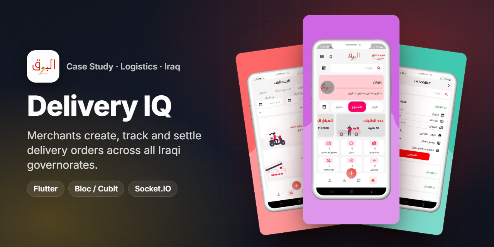
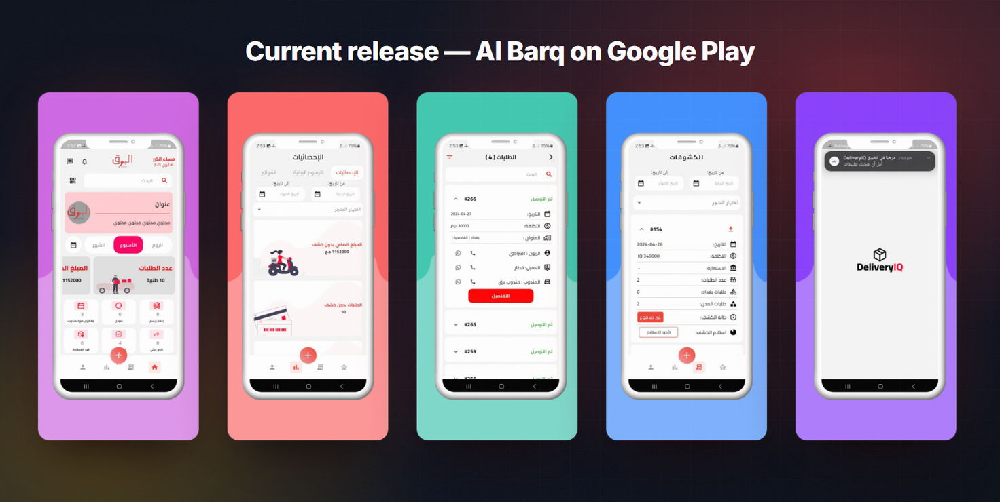
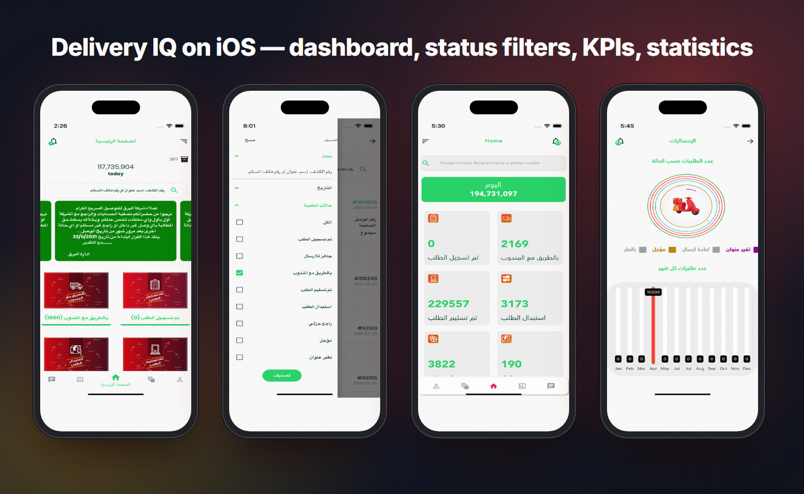
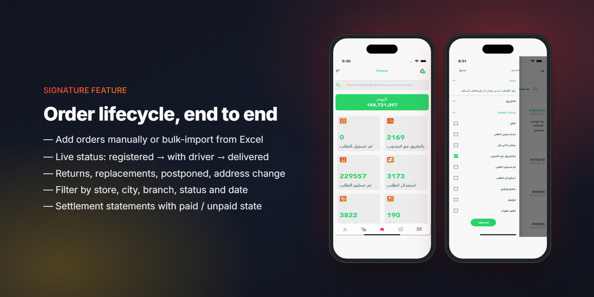
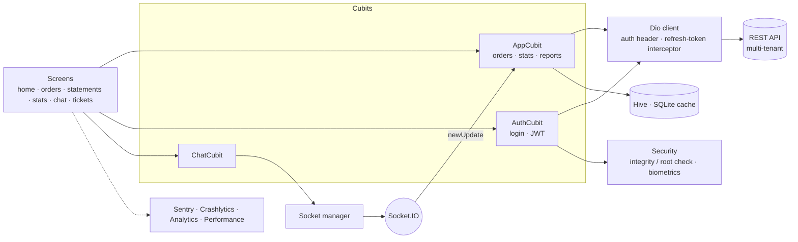

<h1 align="center">Delivery IQ · Al Barq</h1>

<b>The merchant app of Al Barq, an Iraqi delivery company: create orders, follow every status live, and settle accounts — from the phone.</b>

  
  
  
  
  
  

  
  

> ℹ️ Case study — the source code is proprietary to the client and is not included.

## Overview

**Al Barq** (البرق — "lightning") delivers parcels for online shops to every governorate in Iraq, with delivery within 24 hours of pickup. **Delivery IQ** is the app the company gives its merchants: shops add their orders, follow them until delivery, see what is owed to them, and talk to the company — instead of calling and sending spreadsheets on WhatsApp.

| | |
|---|---|
| **Client** | Al Barq — Iraqi last-mile delivery company |
| **Users** | Merchants / online stores and their staff |
| **Platforms** | Android (Google Play: *Al Barq*) and iOS (App Store: *Delivery IQ*) |
| **My role** | Flutter developer — app architecture, order flows, statistics, real-time updates, releases |
| **Timeline** | On the App Store since June 2021; updated through 2024+ (store version 3.6.8) |

## The challenge

- **Hundreds of thousands of orders, many states.** An order can be registered, ready to ship, with the driver, delivered, replaced, partially returned, postponed or have its address changed. Merchants need to see all of it at a glance.
- **Money is the real product.** Merchants care about *how much they are owed*: delivery charges, collected amounts and which settlement statements are paid.
- **Bulk entry.** Big shops create dozens of orders a day; typing them one by one was not an option.
- **Trust and security.** The app shows financial data, so sessions, devices and crashes have to be handled carefully.

## Highlights

**📦 Orders**
- Create orders manually (receiver, city, address, price, quantity, *normal* or *replacement* delivery) or **import them from Excel**
- Order list with search by receipt number, name or phone, and filters by **store, city, branch, status and date**
- Order details with a **tracking timeline**, customer / merchant / driver contacts (call, WhatsApp)
- Order codes and QR / barcode generation and scanning

**💰 Money & reports**
- Home KPIs: today's total, counts per status, net amount
- **Settlement statements** (كشوفات) per store with cost, Baghdad vs. other cities, paid / unpaid state and receipt confirmation
- Statistics with charts (per status, per month), invoices and PDF export

**🧑‍💼 Business tools**
- Multi-store (tenant) and branch support; staff accounts for a merchant
- In-app chat with the company and support tickets
- Notifications centre with push (FCM)
- Biometric sign-in, light / dark theme, Arabic-first RTL UI

## Screens

Current Android release (Al Barq): home with KPIs, statistics, orders with tracking, settlement statements, splash.

Delivery IQ on iOS: dashboard by status, status filters, live counters, monthly statistics.

## Signature feature — the order lifecycle, end to end

**How it works**
1. **Create** — a merchant adds an order in a form, or uploads an Excel template that is parsed on the device, matched to delivery regions, previewed and submitted as a batch.
2. **Follow** — each order moves through the company's statuses; the dashboard shows a counter per status, and every order has a timeline of its history.
3. **Live updates** — a Socket.IO connection registers the user and receives `newUpdate` / `newMessage` events, so counters and chats refresh as soon as the company updates an order.
4. **Settle** — delivered orders roll up into settlement statements; the merchant sees amounts, paid / unpaid state, and confirms receipt in the app.

## Architecture & stack

| Layer | Tech |
|---|---|
| UI | Flutter, `flutter_screenutil` / `sizer`, `animate_do`, staggered animations, `timeline_tile`, `flutter_svg` |
| State | `flutter_bloc` — App, Auth and Chat cubits |
| Networking | Dio with auth header and refresh-token interceptor; `jwt_decoder` |
| Real-time | `socket_io_client` (chat messages, order updates) |
| Data import / export | `excel` (bulk orders), `file_picker`, `pdf` + `printing`, `open_file` |
| Charts | `syncfusion_flutter_charts`, `fl_chart` |
| Codes | `qr_flutter`, `qr_code_scanner_plus` |
| Security | Play Integrity via platform channel, `root_checker_plus`, `local_auth`, Firebase App Check |
| Observability | Sentry (Flutter + Dio + logging), Firebase Crashlytics, Analytics, Performance |
| Storage | Hive, SQLite helper, shared-preferences cache |

## Engineering notes

- **Silent token refresh.** A Dio interceptor catches `401`, calls the refresh endpoint with the stored refresh token, saves the new access token and retries the original request — users are not kicked out in the middle of their work.
- **Device trust check.** On start-up the app asks Android for a Play Integrity verdict through a platform channel; if that is unavailable it falls back to a root check and fails safe.
- **Real-time without polling.** One socket manager handles `chatMessages`, `newMessage` and `newUpdate` events and feeds them into the cubits, so chat and order counters stay current.
- **Bulk orders from Excel.** Merchants fill a template sheet with Arabic column headers (phone, governorate, area, address, total, notes). The app parses it on the device, maps columns by header name rather than position, matches each area to the server's list of delivery regions, flags rows whose region is unknown, and shows a preview before the batch is submitted.
- **Every request is measurable.** API calls carry an event name that is also logged to Firebase Analytics, and Sentry wraps the app and the Dio client — errors arrive with the request that caused them.
- **Built-in analytics screens.** An internal dashboard tab shows Crashlytics and Performance views, which helped the team watch stability release by release.

## Results

- **5K+ installs** on Google Play, rated **5.0★** (Google Play listing "Al Barq").
- Live on the **App Store since June 2021** (Shopping · Utilities), store version 3.6.8.
- Serving merchants shipping to **all Iraqi governorates**, with delivery within 24 hours (App Store description).

## بالعربي

**Delivery IQ / البرق** تطبيق التجّار لشركة البرق للتوصيل في العراق.
التاجر يضيف طلباته يدويًا أو **يرفعها من ملف Excel**، ويتابع كل طلب بحالته (تم التسجيل، مع المندوب، تم التسليم، استبدال، راجع جزئي، مؤجل، تغيير عنوان) مع خط زمني لكل طلب.
يعرض التطبيق الإحصائيات والكشوفات المالية (مدفوع / غير مدفوع) والدردشة مع الشركة والتذاكر، مع تحديثات لحظية عبر Socket.IO.
أمان: تجديد التوكن تلقائيًا، فحص سلامة الجهاز، الدخول بالبصمة، ومراقبة الأخطاء عبر Sentry وCrashlytics.
دوري: تطوير التطبيق بـ Flutter — المعمارية، دورة الطلب، الإحصائيات، التحديث اللحظي، والنشر.

## Links

- Google Play (Al Barq) — https://play.google.com/store/apps/details?id=com.delivery.iq
- App Store (Delivery IQ) — https://apps.apple.com/app/id1568878714

---
<h3 align="center">Built by Mahmoud Shaker — Senior Flutter Engineer</h3>

  
  
  
  
  
  
  

